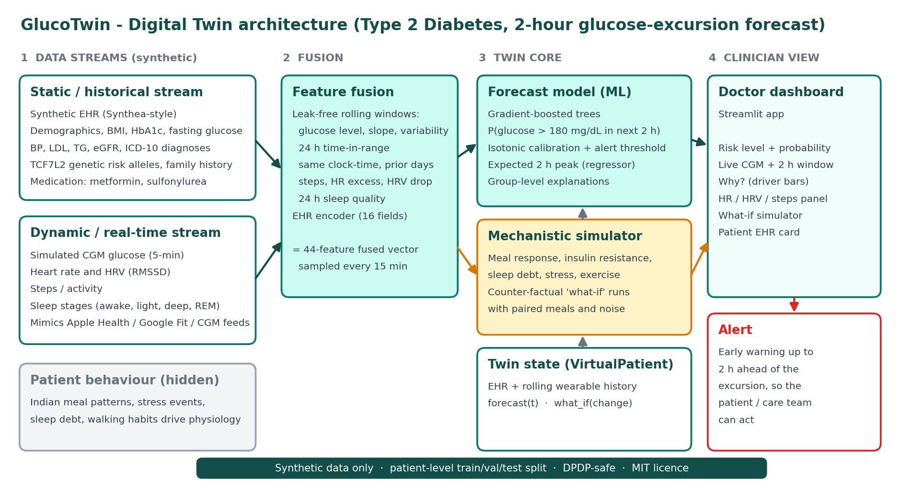
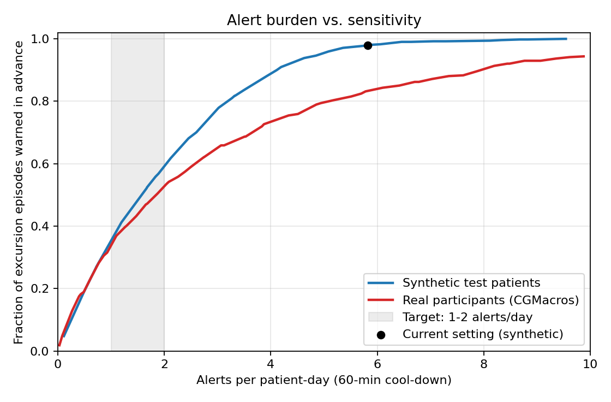
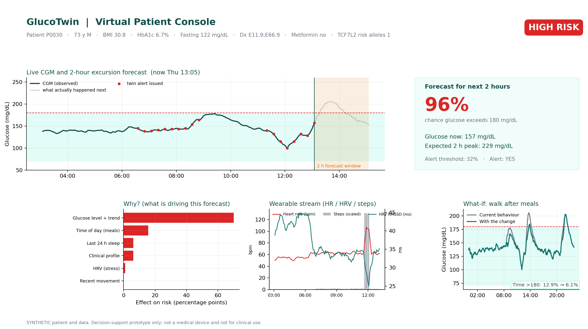

# GlucoTwin: a Digital Twin for Type 2 Diabetes glucose-excursion forecasting

> Proof-of-concept for the **Happiest Health "Reimagining and Reforming Healthcare in India" Summit 2026** Digital Twin challenge.
> The prototype is built and trained on **synthetic data**, and its forecaster is additionally checked on a **real open dataset (CGMacros)**. This is a research prototype, **not a medical device** and not for clinical use.

## 1. Team details and college / incubator information
| Field | Details |
|---|---|
| Team name | Digital Twiner |
| College / incubator | Birla Institute of Technology, Mesra |
| Team leader | Rohan Kumar, rohankumar18181818@gmail.com, 9155554554 |
| Members (1-4) | Subhrank Priya, B.Tech, Final Year |

*(Folder / repo name format required by the organisers: `TeamName_CollegeName`, here `DigitalTwiner_BITMESRA`.)*

## 2. Project title
**GlucoTwin: fusing EHR and wearable/CGM streams in a virtual patient that warns of glucose excursions 2 hours ahead.**

## 3. Problem statement and healthcare use case
India has an estimated 101 million people living with diabetes (ICMR-INDIAB study: Anjana RM et al., *Lancet Diabetes & Endocrinology*, 2023, DOI 10.1016/S2213-8587(23)00119-5), and most of the harm comes from poorly controlled glucose between clinic visits. A doctor sees a patient for minutes every few months, while the patient's glucose, sleep, activity and stress change every few minutes.

**Condition chosen:** Type 2 Diabetes (T2D).
**Adverse event predicted:** a hyperglycaemic excursion, defined as *glucose rising above 180 mg/dL at any point in the next 120 minutes* (the ADA "time above range" level), for a patient who is currently not already above 160 mg/dL.
**Who uses it:** a diabetologist / care team gets a virtual replica of each patient, an early warning, an explanation of *why*, and a *what-if* tool ("would a 15-minute walk after lunch help this patient?") that pure prediction models cannot offer.

## 4. What the prototype demonstrates (challenge checklist)
| Requirement | Where |
|---|---|
| Static / historical stream: simulated EHR (demographics, diagnoses, labs, genetic markers) | `glucotwin/synthetic.py::make_ehr` (Synthea-style; ICD-10 diagnoses, HbA1c, eGFR, lipids, TCF7L2 risk alleles, medications) |
| Dynamic stream: simulated wearable / CGM time series (HRV, CGM, sleep stages, steps) | `glucotwin/synthetic.py::simulate_patient` (5-minute CGM, HR, HRV-RMSSD, steps, sleep stages) |
| Fusion of both streams in one model | `glucotwin/features.py` (44-feature fused vector) and `glucotwin/model.py` |
| Working algorithm that predicts an adverse event ahead of time | `GlucoForecaster`: P(glucose > 180 mg/dL within 2 h) + expected 2 h peak |
| Digital twin with forecast + what-if + parameter calibration | `glucotwin/twin.py` (`VirtualPatient.forecast`, `.what_if`, `.calibrate_ir`) |
| Conceptual doctor-facing UI | `app/dashboard.py` (interactive Streamlit) and `docs/figures/clinician_dashboard.png` |
| Only synthetic / anonymised data | The prototype is trained on fully synthetic data. The extra real-data check uses the de-identified, open-access CGMacros dataset (PhysioNet), which is **not** stored in this repository |

## 5. Technical stack, AI/ML model and framework
* **Language / libs:** Python 3.9+ (tested on 3.9), NumPy, pandas, scikit-learn, matplotlib, joblib, Streamlit.
* **Model:** `HistGradientBoostingClassifier` (forecast probability) + isotonic calibration on validation patients + `HistGradientBoostingRegressor` (expected 2 h peak). The alert threshold is chosen on validation patients for roughly 80% sensitivity.
* **Digital-twin design (hybrid):** `VirtualPatient` = static EHR + rolling wearable history. It offers `forecast(t)` (data-driven) and `what_if(change)` (mechanistic simulator re-run with paired meals and noise, so differences come only from the change).
  **Proof-of-concept note:** `what_if` runs the simulator with insulin resistance (IR) *estimated* from the patient's first 5 days of CGM (`VirtualPatient.calibrate_ir`, fitted with different meal/noise seeds from the observed data, matching summary statistics only). Recovery on 150 synthetic patients: r = 0.88, MAE 0.094 (0.164 when predicting the cohort mean). Walk habit, resting HR, meal timings and the noise seed are still the synthetic patient's true values. Because the same simulator generates and fits the data, recovery is optimistic; estimating these on real patients is future work.
* **Features (44, leak-free):** glucose level / slope / variability, 24 h time-in-range, "what happened after this same clock time on previous days", steps, heart-rate excess, HRV drop (stress), 24 h sleep duration and stage fractions, time of day, plus 16 EHR fields.
* **Explainability:** per-forecast driver bars (each feature group replaced by a typical-patient value) and global permutation importance by group.
* **Evaluation protocol:** patient-level train / validation / test split (no patient in two splits), 3 repeated splits, ablations, baselines, calibration, alert burden. Real-data check: participant-grouped cross-validation with bootstrap confidence intervals over participants.



## 6. Results

### 6.1 Held-out synthetic patients (150-patient cohort, 14 days each, 5-minute resolution)
Mean ± sd over 3 random patient-level splits.

| Model | AUROC | AUPRC |
|---|---|---|
| EHR only | 0.674 ± 0.014 | 0.279 ± 0.015 |
| CGM only | 0.942 ± 0.004 | 0.768 ± 0.022 |
| Wearables only (no EHR) | 0.942 ± 0.004 | 0.772 ± 0.021 |
| **Fused EHR + wearables (GlucoTwin)** | **0.942 ± 0.004** | **0.775 ± 0.024** |
| Cold start (no personal history yet): wearables only | 0.935 ± 0.006 | 0.739 ± 0.032 |
| Cold start: wearables + EHR (fused) | 0.940 ± 0.005 | 0.762 ± 0.025 |
| Baseline: logistic regression on current glucose + trend (primary split) | 0.608 | 0.260 |

Event prevalence among eligible forecast times is about 17%. On the primary split the fused model has about 89% sensitivity / 87% specificity / 62% precision at its validation-chosen threshold, a 2 h peak MAE of about 11.5 mg/dL, and it pre-warned 510 of 521 (98%) excursion episodes, at the cost of about 6 alerts per patient-day (with a 60-minute cool-down).

**Honest reading of the synthetic numbers**
* Recent glucose history and time-of-day (meal habits) carry most of the signal. EHR-only is weak (AUROC about 0.67): static records alone cannot time an excursion.
* **Fusion gives a small gain once a patient has CGM history in simulation** (AUPRC 0.768 to 0.775, within one standard deviation). Its clearest value is in the **cold-start** setting, where adding the EHR lifts AUPRC from 0.739 to 0.762 (about one sd, 3 splits only). **This gain was not reproduced on real data (see 6.2).**
* In this synthetic world, HRV, sleep and steps contribute little to the *forecast* (global importance about 0.001 to 0.006 AUROC) even though they drive the simulated physiology. The wearable signals mainly add explanatory context for the clinician. We report this as measured rather than claiming otherwise.
* Because these labels come from our own simulator, **the synthetic metrics measure how well the pipeline learns a known process, not real-world clinical accuracy.**

What-if example (patient `P0030`, same meals and noise, using the patient's true IR): a 15-minute walk after each main meal reduces time above 180 mg/dL from 12.9% to 6.1% and mean daily peak from 231 to 205 mg/dL. This comes from the mechanistic simulator's assumptions, not from clinical evidence. See 6.4 for how the result changes when IR is estimated from CGM instead.

### 6.2 Real-data validation (CGMacros v1.0.0, open access, PhysioNet)
45 adults (15 healthy, 16 prediabetes, 14 T2D by HbA1c), about 10 days each, Dexcom G6 Pro glucose, 25,306 eligible forecast times, event prevalence 12.1%. Only CGM-derived and time-of-day features are used (HRV, sleep and steps do not exist in this dataset). Uncertainty is a 95% bootstrap confidence interval that resamples whole participants.

| Setting | AUROC (95% CI) | AUPRC |
|---|---|---|
| A. Trained on synthetic only, tested on real | 0.826 (0.795-0.853) | 0.422 |
| B. Trained and tested on real (participant-grouped CV), CGM only | 0.827 (0.795-0.852) | 0.454 |
| B + 7 shared EHR fields | 0.817 (0.783-0.842) | 0.446 |
| A, T2D participants only (n=14) | 0.835 (0.811-0.856) | 0.554 |
| B, T2D participants only (n=14) | 0.820 (0.799-0.835) | 0.577 |

* **Sim-to-real gap:** AUROC falls from 0.94 on synthetic patients to about 0.83 on real participants.
* A model trained only on synthetic data transferred about as well as one trained on real data (0.826 vs 0.827). One reading is that the simulator captures the glucose dynamics a CGM forecaster can use; the real-trained model may also be limited by its small training set.
* **EHR fusion gave no measurable gain on real data** (45 participants, 7 shared fields). The fusion benefit is therefore shown only in simulation.
* **Sensor sensitivity check:** using the Libre Pro readings instead gave a higher AUROC (about 0.89 to 0.90) and a lower event prevalence (5.4%). The Libre values may be interpolated from a coarser native interval, so Dexcom (chosen in advance) is the primary result.
* **Limits:** one US site, mostly mild T2D, 45 participants, no HRV / sleep / steps. This is not clinical evidence.

### 6.3 Alert burden (60-minute cool-down)
Fraction of excursion episodes warned in advance, for a given daily alert budget:

| Alerts per patient-day | Real participants (cross-validated) | Synthetic test patients |
|---|---|---|
| 1 | 31.5% | 26.9% |
| 2 | 50.5% | 56.8% |
| 3 | 62.1% | 70.1% |
| 5 | 79.4% | 94.6% |

The original operating point (about 5.8 alerts per patient-day) warned 97.9% of episodes in simulation. A realistic budget of about 2 alerts per day warns roughly half of the episodes. Thresholds were picked on the same predictions they are reported on, so these figures are illustrative. A two-tier design is proposed: a continuous risk bar on the dashboard, with push alerts only at the low-alert-budget threshold. The right operating point should be set with clinicians.



### 6.4 Digital-twin calibration check (synthetic patients only)
`VirtualPatient.calibrate_ir` estimates the latent insulin-resistance parameter from the first 5 days of a patient's CGM. It searches a grid of IR values (0.30 to 1.60, step 0.05), simulates each with **different meal/noise seeds** from the observed data, and matches summary statistics only (mean, SD, % time above 180 mg/dL, mean daily peak).

| Metric (150 synthetic patients) | Value |
|---|---|
| Correlation, estimated vs true IR | 0.88 |
| MAE of estimated IR | 0.094 |
| MAE when predicting the cohort mean IR | 0.164 |
| SD of true IR | 0.196 |

Effect on the what-if result (15-minute walk after main meals, first 5 patients, reduction in time above 180 mg/dL in percentage points):

| Patient | True IR | Estimated IR | Benefit with true IR | Benefit with estimated IR |
|---|---|---|---|---|
| P0000 | 0.705 | 0.85 | 6.28 | 5.93 |
| P0001 | 0.864 | 0.75 | 5.98 | 5.34 |
| P0002 | 0.691 | 0.60 | 3.66 | 2.78 |
| P0003 | 0.430 | 0.30 | 2.24 | 1.04 |
| P0004 | 0.498 | 0.40 | 0.85 | 0.27 |

* In all 5 patients checked, the benefit of the walk was somewhat **underestimated** with estimated IR. This is a small example, not a general claim.
* The estimate for P0003 sits at the lower edge of the search grid (0.30), so the grid range may be too narrow for low-IR patients.
* **Caveat:** the same simulator generates and fits the data, so this recovery is optimistic. It shows the calibration idea works in principle, not that it would work on real patients. Walk habit, resting HR, meal timings and the noise seed are still true values.
* Reproduce with `python scripts/calibrate_twin.py` (about 20 s) -> `artifacts/twin_calibration.json`.



## 7. How to run
```bash
git clone https://github.com/subhrank09/DigitalTwiner_BITMESRA.git && cd DigitalTwiner_BITMESRA
python -m venv .venv && source .venv/bin/activate        # Windows: .venv\Scripts\activate
pip install -r requirements.txt

python scripts/run_pipeline.py --quick     # ~1 min: small cohort, single split
python scripts/run_pipeline.py             # full run (~5-8 min): data, 3-split evaluation, figures, model
python scripts/calibrate_twin.py           # twin IR-calibration check -> artifacts/twin_calibration.json (~20 s)
streamlit run app/dashboard.py             # interactive clinician console
pytest -q                                  # 7 tests incl. a no-future-leakage test and a twin-calibration test
python scripts/make_architecture.py        # regenerates docs/architecture.pdf
```
Outputs: `data/synthetic/` (EHR, 5-min wearables, meal ground truth), `artifacts/` (model, `metrics.json`, test predictions, `twin_calibration.json`), `docs/figures/`.

**Optional: real-data validation (CGMacros, not included in this repository)**
1. Download `CGMacros_dateshifted365.zip` from https://physionet.org/content/cgmacros/1.0.0/ (check and follow the licence stated on that page).
2. Put `bio.csv` and each participant's CSV into `data/real/cgmacros/` (`data/real/cgmacros/CGMacros-001/CGMacros-001.csv`, and so on).
3. Run:
```bash
python scripts/run_real_validation.py                       # experiments A and B -> artifacts/real_validation.json
python scripts/run_real_validation.py --oof-out artifacts/real_oof_dexcom.csv
python scripts/make_alert_curve.py                          # alert trade-off figure and tables
```
Dataset citation: Gutierrez-Osuna R, Kerr D, Mortazavi B, Das A. (2025). *CGMacros: a scientific dataset for personalized nutrition and diet monitoring* (version 1.0.0). PhysioNet. https://doi.org/10.13026/3z8q-x658. Licence and access terms: as stated on the dataset page (https://physionet.org/content/cgmacros/1.0.0/); we use it only for validation and do not redistribute it.

## 8. Data sources and privacy
The prototype is trained on data generated by our own code (`glucotwin/synthetic.py`), so no personal data is processed for training. EHR fields follow the structure of Synthea-style records (ICD-10 coded diagnoses, labs, medications). The additional real-data check uses CGMacros, a de-identified open-access dataset from PhysioNet, which we do not redistribute (`data/real/` is excluded from version control). Details in [`docs/DATA_CARD.md`](docs/DATA_CARD.md). A larger real T2D dataset (ShanghaiT2DM, 100 patients) is a candidate for future validation, subject to its licence.

## 9. Limitations and responsible use
See [`docs/MODEL_CARD.md`](docs/MODEL_CARD.md). In short:
* The model is trained on synthetic data from a simplified physiology simulator; real-data validation covers 45 adults at one site and is not clinical evidence.
* EHR fusion helped only in simulation; it was not detected on real data.
* The what-if tool is a simulation, not a prescription. IR is estimated from CGM, but other latent parameters (walk habit, resting HR, meal timings, noise seed) are still the synthetic patient's true values, and calibration was only tested in simulation, where it is optimistic because the same simulator generates and fits the data.
* Results depended on the CGM sensor (Dexcom vs Libre).
* Fixed 180 mg/dL threshold; alert fatigue risk (see 6.3); operating points were not chosen on separate data.
* No regulatory clearance.

## 10. Open-source licence
MIT, see [`LICENSE`](LICENSE). Third-party libraries keep their own licences (BSD / MIT / Apache-2.0). The CGMacros dataset keeps its own licence.

## 11. Submission documents
| Item | File |
|---|---|
| Architecture diagram (PDF) | [`docs/architecture.pdf`](docs/architecture.pdf) |
| Presentation (PPT + PDF) | [`docs/GlucoTwin_Presentation.pptx`](docs/GlucoTwin_Presentation.pptx), [`docs/GlucoTwin_Presentation.pdf`](docs/GlucoTwin_Presentation.pdf) |
| Source code repository | https://github.com/subhrank09/DigitalTwiner_BITMESRA |
| Demo video (≥ 20 min) | `<UNLISTED YOUTUBE LINK>` (script: [`docs/VIDEO_SCRIPT.md`](docs/VIDEO_SCRIPT.md)) |

## 12. Repository layout
```
glucotwin/   synthetic.py  features.py  model.py  twin.py  plots.py  real_cgmacros.py  real_adapter.py
scripts/     run_pipeline.py  make_architecture.py  render_dashboard_png.py  run_real_validation.py  make_alert_curve.py  calibrate_twin.py
app/         dashboard.py                      (Streamlit clinician console)
tests/       test_pipeline.py
pytest.ini                                     (puts the repo root on the import path)
data/        synthetic/                        (generated)   real/  (CGMacros, you download it; git-ignored)
artifacts/   model, metrics, predictions, real_validation*.json, twin_calibration.json, alert sweeps   (generated)
docs/        architecture.pdf, presentation, figures/, DATA_CARD.md, MODEL_CARD.md, VIDEO_SCRIPT.md
```
